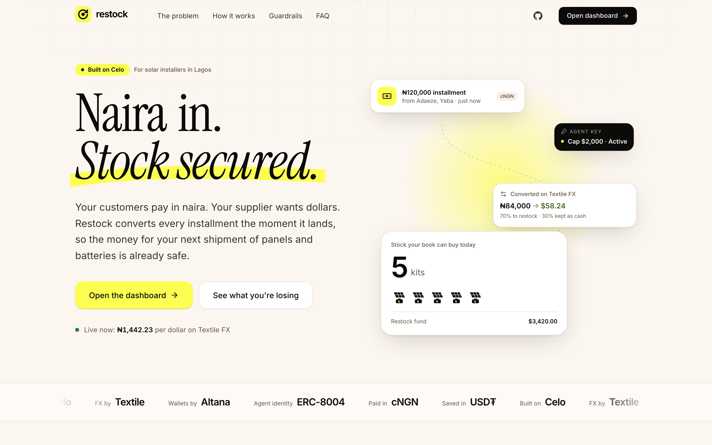
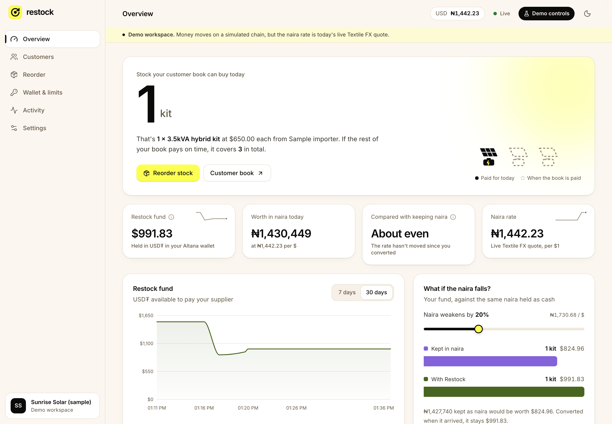
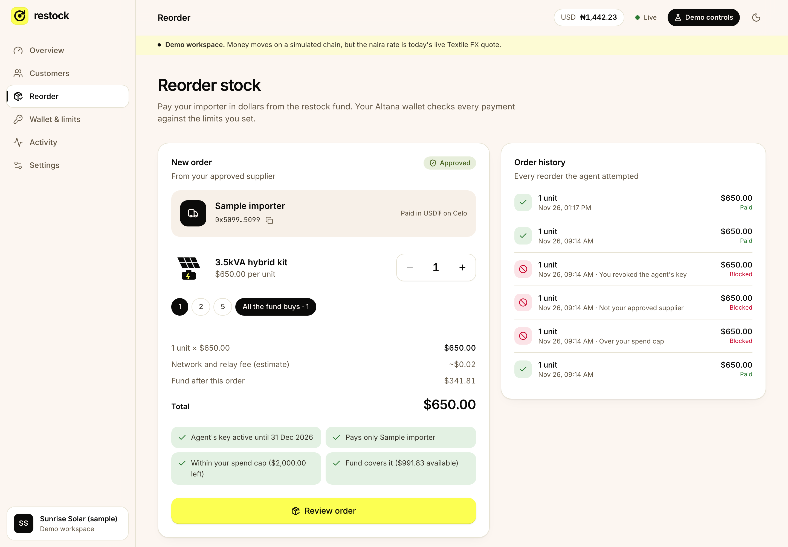
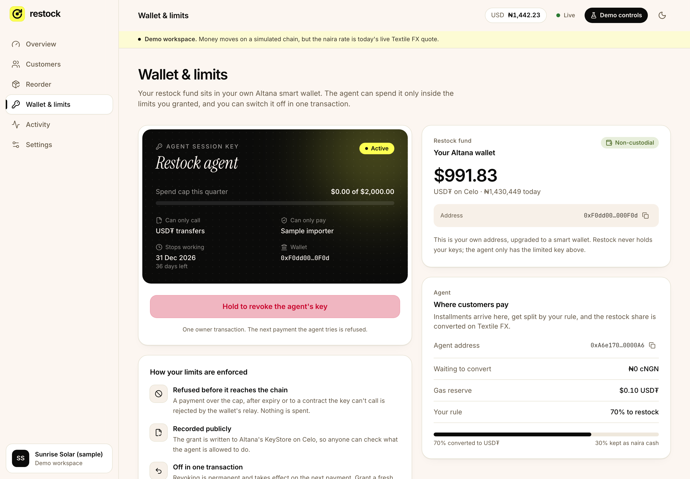
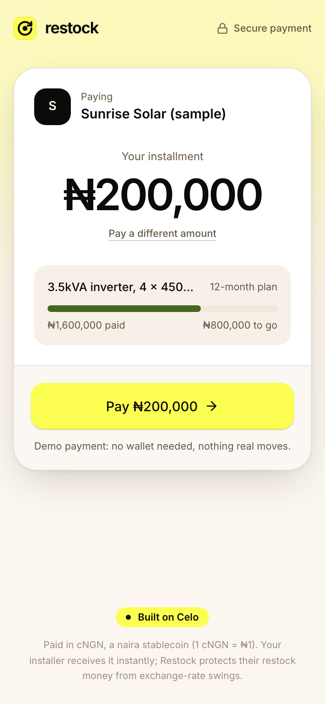
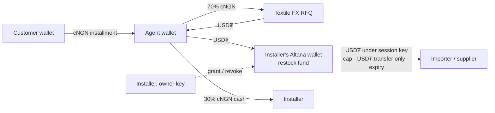

# Restock

**Protecting solar installers from naira devaluation.** An agent on Celo that takes customers' naira installments, keeps the restock share in dollars as it arrives, and pays the importer from a wallet the installer controls and can switch off.

> Built for [Agents Open for Business](https://www.loops.house/agents-open-for-business): Stablecoin Corridors (Textile FX) and Altana Smart Agentic Wallets tracks.



| The one number | Reorder, inside your limits |
|---|---|
|  |  |
| **The agent's key, as a pass you can revoke** | **Customer pays from their own wallet** |
|  |  |

## The problem

Lagos has thousands of small solar and inverter installers who sell systems on monthly installments in naira. Their restock costs follow the dollar: Nigeria imports roughly 90–95% of its solar components. An installer sells a system for ₦2.4m over 12 months, and by month 12 those naira may not buy the replacement stock. Large pay-as-you-go companies hedge this internally. Small installers just absorb the loss.

## What Restock does

1. **Customers pay installments in cNGN** (a naira stablecoin, 1 cNGN = ₦1) from their own wallets, through a payment link.
2. **The agent converts each payment as it arrives**, following the installer's rule (default: 70% to the restock fund). The restock share is sold for USD₮ on **Textile FX** and moved into the installer's restock wallet. The 30% cash share goes to the installer in cNGN.
3. **When it's time to reorder**, the agent pays the importer in USD₮ from an **Altana smart wallet**. The wallet is the installer's own address, and the agent acts under a session key that:
   - can only call `USD₮.transfer`;
   - has a spend cap;
   - expires at the end of the quarter;
   - can be revoked in one transaction.
4. **The installer sees one number**: how many units of stock their customer book can buy today. Beside it is a "what if the naira falls 20%?" comparison with keeping the naira.



The currency conversion is the product, not a swap button bolted onto a payments app. The same tool works for anyone selling imported goods on installment: phones, generators, laptops.

## Track requirements

| Requirement | Where |
|---|---|
| Tagged Textile FX conversion on Celo mainnet (cNGN → USD₮), in the product flow | [`src/textile.ts`](src/textile.ts), called from [`src/agent.ts`](src/agent.ts) for every batch of installments. The swap is sent from the agent wallet with our ERC-8021 tag appended. |
| Payments in a local stablecoin reach a recipient outside the team | Customers (outside the team) pay cNGN to the installer's agent, and the installer receives the cNGN cash share. |
| Agent acts from an Altana wallet on Celo mainnet | [`src/rails/live.ts`](src/rails/live.ts) `paySupplier` calls `client.execute({ session, … })`. |
| Session key with spend cap, contract allowlist and expiry | [`scripts/grant.ts`](scripts/grant.ts): `USD₮.transfer` only, `SESSION_CAP_USDT`, end-of-quarter expiry. Live limits are read back from the wallet and shown on the dashboard. |
| Revoke transaction, and the agent being stopped | [`scripts/revoke.ts`](scripts/revoke.ts). After revoke, the next reorder comes back `session_revoked` and the dashboard shows it. |
| ERC-8004 identity | [`scripts/register-agent.ts`](scripts/register-agent.ts) registers from the agent wallet. |
| Attribution tag on every transaction | [`src/chain.ts`](src/chain.ts): a client-level `dataSuffix` on the agent's wallet client. Altana calls carry it via `appCode`, and the customer pay page appends it too. |

## Run it

Requires Node ≥ 22.13 (uses built-in `node:sqlite`).

### Simulation (no keys, no funds)

```bash
npm install
```
```bash
npm run seed:sample
```
```bash
npm run dev
```

Open http://localhost:5173 (Vite, with the API on :8787 behind it). For a production build served by the API alone:

```bash
npm run build && npm start
```

In simulation mode the chain is in memory, but **the naira rate is today's live Textile FX quote**. Open **Demo controls** in the top bar to make a customer pay, move the naira, or revoke the agent's key. Then reorder stock and try going over the cap.

### Celo mainnet

Each step says whose key it uses. The owner (installer) key never goes into the running agent.

1. `cp .env.example .env`, set `MODE=live`, `ATTRIBUTION_CODE` (from your loops.house entry), `INSTALLER_NAME`, `SUPPLIER_NAME`, `SUPPLIER_ADDRESS`, `UNIT_NAME`, `UNIT_USD_COST`.
2. **Installer:** `npm run wallet:create`. This turns a fresh owner key into an Altana wallet (same address). Fund it with about 25 CELO for KeyStore registration fees and a little USD₮ for relay fees.
3. **Installer:** `npm run grant`. This grants the agent's session key and writes `data/session.json`.
4. **Agent:** `npm run agent:setup`. This creates the agent key and sets a standing cNGN allowance for Textile. Send the agent wallet about 0.2 USD₮ for gas first; it pays gas in USD₮ via Celo fee abstraction.
5. **Agent:** `npm run agent:register` registers the ERC-8004 identity.
6. `npm run status` is a preflight check. Then `npm start`.
7. Add the installer's customers on the dashboard. Each row has a payment link (`/pay?wallet=0x…`) the customer opens in their wallet browser.
8. To demo the guardrails: pay the supplier, then try more than the cap, then `npm run revoke` and try again.

## Demo script (2–3 minutes)

1. **The loss.** The installer sold a ₦2.4m system on 12 months. Slide "What if the naira falls?" to 20% and show the gap, for example 1 kit if kept in naira against 2 with Restock.
2. **A customer pays.** They open the payment link and send ₦200,000 cNGN from their own wallet.
3. **The agent converts.** The activity feed shows ₦140,000 → USD₮ on Textile FX (with the Celoscan link and tag), the USD₮ moved into the Altana wallet, and ₦60,000 sent to the installer as cash.
4. **The one number goes up.** Then reorder 1 kit, and the importer is paid in USD₮ from the Altana wallet.
5. **Guardrails.** A reorder over the cap is refused by the relay, so nothing goes onchain. Then the installer revokes the key in one transaction, and the next reorder is blocked: `session_revoked`.

## Design notes and honest limits

- **Supplier allowlist is enforced by the agent, not the chain.** Altana session keys restrict the target contract and function (`USD₮.transfer`) but not the recipient. The spend cap and expiry are enforced onchain. Pinning the recipient onchain needs a custom `ICallChecker` contract on the account (`setCallChecker`). That is the next step, not built yet.
- **Altana's cap period.** Altana has no "quarter" period, so the grant uses a `year` cap with an end-of-quarter expiry. That makes the cap a per-session total. Relay fees count toward it.
- **Altana-relayed transactions.** The tag is on the inner call (`appCode`); the outer transaction is sent by the relay. Whether the hackathon's checker credits these depends on [celo-org/attribution-tags#32](https://github.com/celo-org/attribution-tags/pull/32). Textile swaps, sweeps and cash transfers are sent by the agent wallet and tagged at the end of calldata.
- **Customers need gas.** cNGN is not a Celo fee currency, so customers need a little CELO or USD₮.
- **Small payments are batched.** Textile's floor is about $1, so installments under `MIN_CONVERT_CNGN` wait and are converted together.
- **cNGN regulation is early.** WrappedCBDC holds SEC ARIP approval-in-principle, not a final licence.
- **No custody by us.** The restock wallet is the installer's own address. The agent key can only do what the session key allows, and the installer can revoke it at any time.

## Layout

```
src/
  agent.ts        the loop: ingest → split → convert → sweep; reorders
  textile.ts      Textile FX RFQ v2 client (keyless taker proof, approve, swap, submit)
  altana.ts       Altana client, session storage, onchain limit readers
  chain.ts        viem clients: attribution tag + USD₮ gas on every tx
  stock.ts        the one number, and the naira comparison
  ledger.ts       SQLite record of payments, conversions, orders, activity, chart snapshots
  settings.ts     the installer's rule, unit and supplier (editable; supplier env-locked in live)
  rails/          live (Celo mainnet) and sim implementations of the same interface
  server.ts       API, live event stream (SSE) and the built web app
scripts/          wallet:create, grant, revoke, agent:setup, agent:register, status
scripts/brand/    renders the social image, icons and README screenshots with headless Chrome
web/src/
  pages/          landing, installer app (overview, customers, reorder, wallet, activity, settings), pay flow
  components/ui/  design system: buttons, cards, dialog/sheet, form controls, meter, segmented, hold-to-confirm
  components/     app shell, charts, landing sections, brand mark
  lib/            typed API client (types imported from the server), live updates, wagmi config
test/             unit tests; live-readonly.ts is a mainnet read-only smoke test
```

## Design

The interface follows [Celo's brand kit](https://celo.org/brand-kit):
- **Colours:** Gypsum backgrounds, Sand lines, Wood secondary text, Onyx type, Prosperity Yellow calls to action and Forest for protected value.
- **Type:** Instrument Serif stands in for GT Alpina in headlines; Inter is the UI face.
- **Dark mode:** its own set of steps, not an inversion.
- **Charts:** colours are checked for colour-vision deficiency and contrast in both modes. Charts follow one mark spec: 2px lines, a 10% area wash, hairline grids, and a crosshair tooltip.
- **Motion:** Motion's springs throughout, all of it respecting `prefers-reduced-motion`.
- **Stack:** React 19, Vite, Tailwind 4, Radix primitives, TanStack Query and wagmi for the customer's wallet.

## Named users

Fill in before submission: the installer, their customers paying in cNGN, and the importer receiving USD₮, with how you reached them.
